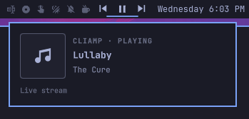

# Simple CLIAmp Bar Controls

An [Omarchy](https://omarchy.org/) bar widget for the [cliamp](https://github.com/bjarneo/cliamp) terminal music player.



- **Bar:** previous, play/pause, and next buttons.
- **Hover:** a card pops out with the current track: cover art, title, artist, album, play state, and a progress bar for tracks with a known length. Internet radio streams show as a live stream.
- The widget hides itself when cliamp isn't running and comes back when it starts.

## Requirements

- Omarchy with the Quickshell-based Omarchy shell
- [cliamp](https://github.com/bjarneo/cliamp) running with its MPRIS service enabled (the default on Linux)

The plugin talks to cliamp only through MPRIS over D-Bus. It runs no commands, makes no network requests of its own, and has no other dependencies.

## Install

```bash
omarchy plugin add https://github.com/mattwolfgang/simple-cliamp-bar-controls --enable
```

The widget is added to the right section of the bar. To put it just left of the clock instead:

```bash
omarchy bar move io.github.mattwolfgang.simple-cliamp-bar-controls --section centerBegin
```

### From a local checkout

```bash
./install.sh            # validate, copy to ~/.config/omarchy/plugins, enable in centerBegin
./install.sh right      # or pick another bar section
```

Re-run `./install.sh` after making changes; the shell hot-reloads the installed copy.

## Remove

```bash
omarchy plugin remove io.github.mattwolfgang.simple-cliamp-bar-controls
```

## Translations

Strings live in `i18n/en.json`. To add a language, add a file named for its Omarchy language code (for example `da.json`) with the same keys.

## License

[MIT](LICENSE)
